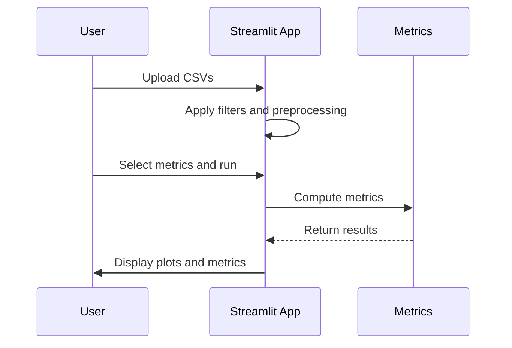

<!-- # Copyright (c) 2025 takotime808 -->
# multioutreg #

Multi-Output Multi-Fidelity Surrogate Modeling with Uncertainty Quantification.

[](https://multioutreg.streamlit.app/)
[](https://takotime808.github.io/multioutreg/)
[](https://www.python.org/)

[](https://takotime808.github.io/multioutreg/coverage/)
[](https://github.com/takotime808/multioutreg/actions/workflows/gh_pages.yml)

<!-- [](https://pypi.org/project/multioutreg/) -->
<!-- [](./LICENSE) -->
<!-- [](https://github.com/takotime808/multioutreg/actions/workflows/python-ci.yml) -->
<!-- [](https://github.com/takotime808/multioutreg/actions/workflows/streamlit-smoke.yml) -->

<!-- backup deployment of `main` prior to claude refactor:

[](https://multioutreg-pre-ai.streamlit.app/) -->

<!-- Moo-regret deployment:

[](https://multioutreg-regret.streamlit.app/) -->

<!-- Original CICD -->
<!-- [](https://codecov.io/gh/takotime808/multioutreg) -->

<!-- Sphinx -->
<!--  -->

<!-- New CICD -->
<!--  -->

<!-- Claude suggested badges. -->
<!-- [](https://www.python.org/)
[](https://github.com/astral-sh/uv)
[](https://github.com/astral-sh/ruff)
[](https://github.com/takotime808/multioutreg/commits/main) -->


This repository provides utilities for evaluating multi-output surrogate models
with uncertainty estimation. Example notebooks in `examples/` demonstrate the
plotting functions and performance metrics. A new script `examples/report.py`
shows how to create an HTML report using a Jinja2 template that collects all
metrics and figures in one document. Output reports are shown in the docs
directory: [example_reports](docs/_extra/example_reports/).

The `AutoDetectMultiOutputRegressor` can now automatically search across all
vendor-provided surrogates. See [`examples/AutoDetectMultiOutputRegressor.ipynb`](./examples/AutoDetectMultiOutputRegressor.ipynb) 
for a short demonstration.

----
## 📦 Features ##

- 🧠 Auto-detect best multi-output regressors with uncertainty support.
- 💰 Fewer expensive simulator runs: active learning, Bayesian optimization and multi-fidelity sampling ([measured savings](docs/cost_savings.md)).
- 📉 Per-target metrics, SHAP plots, UMAP projections, PDPs, residuals.
- 🎯 Multi-objective regret metrics (hypervolume, scalarized, ε-indicator).
- 📊 Exportable HTML reports and Streamlit dashboards.
- 📁 Sphinx documentation with autodoc, tutorials, and CLI docs.
- 🧪 Fully tested with `pytest` and integrated CI.

---
## 🚀 Quickstart ##

**Installation:** (requires Python >= 3.10)
```bash
uv sync --extra test  # or: pip install .[test]
```

Optional surrogates and features are available as extras, e.g.
`pip install ".[xgboost]"`. `pip install ".[all]"` installs every library
feature plus the test tooling. The example-notebook dependencies (`ray`,
`hyperopt`, `plotly`) are kept separate by convention: add them with
`pip install ".[all,examples]"`. See [docs/install.md](docs/install.md) for the
full list.

**Streamlit App:**
```sh
.venv/bin/streamlit run multioutreg/gui/Grid_Search_Surrogate_Models.py
```
Use the `streamlit` from the project environment; a `streamlit` from another
Python (e.g. a base conda env) will fail with import errors.

[Notebooks and scripts](examples/) can be run once the tool is installed.

**CLI:**

```sh
multioutreg
```

Example use command:
```sh
multioutreg grid_search_auto_detect docs/_static/example_datasets/sample_data.csv "x0,x1,x2,x3,x4,x5" "y0,y1"
```

Help menu for any command can be called with flag:
```sh
multioutreg grid_search --help
```

Time series forecasting — two commands are available depending on what you need:

| Command | Approach | When to use |
|---|---|---|
| `ts-forecast` | Zero-shot (Chronos foundation model) | No training data required; fast probabilistic quantile forecasts from a pre-trained model |
| `ts-pipeline` | Trained statistical + deep models (ARIMA, SARIMA, LSTM) | You want to fit models on your own data, rank them by RMSE/MAE/MAPE, and save the best one |

**`ts-forecast`** — CLI for zero-shot forecasting with Chronos / Chronos-Bolt:
```sh
multioutreg ts-forecast data.csv \
  --time-col "Date" \
  --value-cols "revenue" \
  --horizon 30 \
  --model amazon/chronos-bolt-base \
  --out forecast.csv
```

**`ts-pipeline`** — CLI for training ARIMA / SARIMA / LSTM time series models via the ts_dynamic_fit pipeline:
```sh
multioutreg ts-pipeline data.csv \
  --target-col "revenue" \
  --datetime-col "Date" \
  --freq 1D \
  --out-dir ts_pipeline_output/
```

Key differences:
- `ts-forecast` requires no training; `ts-pipeline` trains models on the provided CSV and saves the best to `--out-dir`.
- `ts-forecast` outputs quantile forecasts (e.g. p10/p50/p90); `ts-pipeline` outputs a ranked comparison table and serialized model.
- `ts-pipeline` automatically aggregates row-level data (e.g. one row per order) to the target frequency, and converts percentage-formatted columns to numeric.
- `ts-pipeline` also accepts `--agg` (default `sum`) to control how duplicate timestamps are collapsed.

Full option reference:
```sh
multioutreg ts-forecast --help
multioutreg ts-pipeline --help
```

----
## ☁️ Deployments ##

🖥️ The deployed Streamlit application is available at:  
[https://multioutreg.streamlit.app/](https://multioutreg.streamlit.app/)

📂 Example input files for testing the app can be found here:  
[./docs/_static/example_datasets/](./docs/_static/example_datasets/)

----
## Visual Overview

### End-to-End Flow

From data intake to the exported model: data checks, the sample-size-dependent
evaluation plan, per-output model selection, optional active learning, and the
uncertainty report. Stage-by-stage notes are in
[docs/how_it_works.md](docs/how_it_works.md).

```mermaid
flowchart LR
    %% ---------- 410 Interfaces ----------
    subgraph IF["Interfaces · 410"]
        direction TB
        LIB["Python library<br/>multioutreg · 410a"]
        CLI["CLI · 410b<br/>grid_search, grid_search_auto_detect,<br/>detect_sampling, ts-forecast, ts-pipeline"]
        GUI["Streamlit GUI · 410c<br/>Grid_Search_Surrogate_Models"]
        DOC["Sphinx docs + notebooks · 410d"]
    end

    %% ---------- 420 Data intake & diagnostics ----------
    subgraph DATA["Data intake & diagnostics · 420"]
        direction TB
        CSV[/"CSV + input / output columns · 421"/]
        MISS["Missing-value scan · 422<br/>rows missing a target are dropped"]
        TSQ{"Temporal structure? · 423<br/>ADF, Ljung-Box"}
        SAMP["Sampling-design detection · 424<br/>LHS / Sobol / Halton / grid / random,<br/>KS sample-bias check"]
    end

    %% ---------- 430 Evaluation plan ----------
    subgraph PLAN["Sample-size-dependent evaluation plan · 430"]
        direction TB
        EP{"25% test split<br/>holds ≥ 30 rows? · 431"}
        HO["Holdout 75 / 25 · 432"]
        NCV["Nested 5-fold CV · 433"]
        CQ{"Enough calibration rows<br/>for alpha? · 434"}
        SPC["Split conformal · 435"]
        CVP["CV+ conformal · 436"]
    end

    %% ---------- 440 Candidate surrogates ----------
    subgraph CAND["Candidate surrogates · 440"]
        direction TB
        PRE["Fit on training rows only · 441<br/>KNN imputer, standardise, optional PCA"]
        SCR["Statistical pre-screening · 442<br/>normality, linearity, heteroscedasticity,<br/>multicollinearity, nonlinear dependency"]
        M1(["GP family<br/>GP, ARD-GP, sparse GP, KPLS"])
        M2(["Tree ensembles<br/>RF, ExtraTrees, LightGBM, XGB, CatBoost, NGBoost"])
        M3(["Linear / kernel<br/>Bayesian ridge, SVR, kNN"])
        MN(["Neural / joint<br/>BNN, deep ensemble, MoE"])
    end

    %% ---------- 450 Model selection ----------
    subgraph SEL["Per-output model selection · 450"]
        direction TB
        GS["Inner-CV grid search · 451<br/>n ≤ 100: RepeatedKFold ×3<br/>n ≤ 1000: 10-fold · else 5-fold"]
        RULE["Choose per output · 452<br/>best mean score, or one-SE rule<br/>(simplest model within 1 SE)"]
        BEST(("Best model<br/>per output · 453"))
    end

    %% ---------- 460 Sample enrichment ----------
    subgraph AL["Optional sample enrichment · 460"]
        direction TB
        BUD{"Simulator budget<br/>left? · 461"}
        ASK["ActiveLearner.ask · 462<br/>Sobol pool scored by max-variance,<br/>UCB, EI or PI; batch selection"]
        SIM["Run simulator at new points · 463<br/>single or multi-fidelity"]
    end

    %% ---------- 470 Uncertainty propagation & outputs ----------
    subgraph UQ["Uncertainty quantification & outputs · 470"]
        direction TB
        MET["Accuracy + UQ metrics · 471<br/>R², RMSE, MAE, calibration, coverage"]
        INT["Prediction intervals · 472<br/>Gaussian ±σ and conformal"]
        SENS["Sensitivity + diagnostics · 473<br/>SHAP, PDP, residuals, UMAP, PCA"]
        REP[/"HTML report · 474"/]
        BUN[/"Model bundle (joblib) · 475<br/>imputer + PCA + model + versions"/]
    end

    %% ---------- 480 Time-series branch ----------
    subgraph TS["Time-series branch · 480"]
        direction TB
        ZS["ts-forecast · 481<br/>Chronos zero-shot quantiles"]
        TP["ts-pipeline · 482<br/>ARIMA, SARIMA, LSTM ranked by<br/>rolling-origin RMSE / MAE / MAPE"]
    end

    LIB & CLI & GUI --> CSV
    DOC -.-> LIB
    CSV --> MISS --> TSQ
    TSQ -- "yes" --> ZS & TP
    TSQ -- "no" --> EP
    CSV -.-> SAMP
    EP -- "yes" --> HO
    EP -- "no" --> NCV
    HO & NCV --> CQ
    CQ -- "yes" --> SPC
    CQ -- "no" --> CVP
    SPC & CVP --> PRE
    PRE --> SCR
    SCR --> M1 & M2 & M3 & MN
    M1 & M2 & M3 & MN --> GS
    GS --> RULE --> BEST
    BEST -.-> BUD
    BUD -- "yes" --> ASK --> SIM
    SIM -.->|"append rows, refit"| PRE
    BEST --> MET & INT & SENS
    MET & INT & SENS --> REP
    BEST --> BUN
```



### Sequence of Interactions


