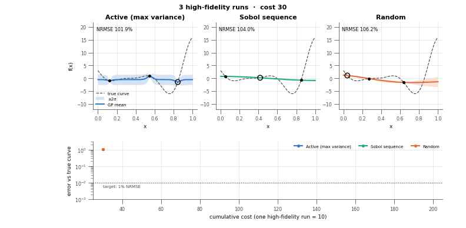
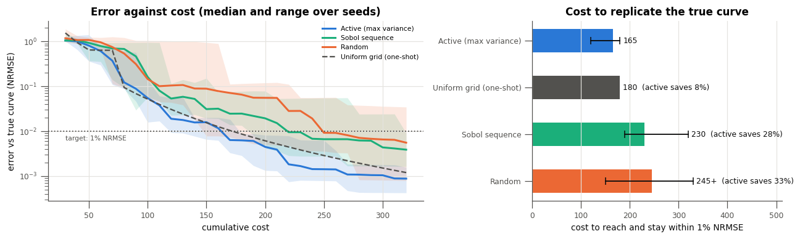

<!-- # Copyright (c) 2026 takotime808 -->
(active-learning-savings)=
# Active Learning: The True Curve for Less

<p class="al-eyebrow">Measured on the Forrester benchmark · median of 8 seeds</p>

<p class="al-lead">Every run of a high-fidelity simulator or experiment costs time and money.
Starting from just 3 runs, <code>multioutreg</code>'s active learner reproduces the true response curve
for <strong>28% less than a Sobol design</strong> and <strong>at least 33% less than random
sampling</strong>, because it places each new run where the model is still uncertain.</p>

<div class="al-savings">
<table>
<thead>
<tr>
<th>Design</th>
<th class="al-num">Runs to 1% error</th>
<th class="al-num">Cost</th>
<th class="al-hide-sm">Relative cost</th>
<th class="al-num">Active saves</th>
</tr>
</thead>
<tbody>
<tr class="al-best">
<td><span class="al-method"><span class="al-swatch active"></span><span>Active learning<small>next run where the GP's band is widest</small></span></span></td>
<td class="al-num">16.5 <small>(12–18)</small></td>
<td class="al-num">165</td>
<td class="al-hide-sm"><div class="al-bar"><span class="active" style="width: 67%"></span></div></td>
<td class="al-num"><span class="al-baseline">best</span></td>
</tr>
<tr>
<td><span class="al-method"><span class="al-swatch grid"></span><span>Uniform grid<small>one-shot; size picked in hindsight</small></span></span></td>
<td class="al-num">18</td>
<td class="al-num">180</td>
<td class="al-hide-sm"><div class="al-bar"><span class="grid" style="width: 73%"></span></div></td>
<td class="al-num"><span class="al-saving">8%</span></td>
</tr>
<tr>
<td><span class="al-method"><span class="al-swatch sobol"></span><span>Sobol sequence<small>next point of a scrambled Sobol sequence</small></span></span></td>
<td class="al-num">23 <small>(19–32)</small></td>
<td class="al-num">230</td>
<td class="al-hide-sm"><div class="al-bar"><span class="sobol" style="width: 94%"></span></div></td>
<td class="al-num"><span class="al-saving">28%</span></td>
</tr>
<tr>
<td><span class="al-method"><span class="al-swatch random"></span><span>Random sampling<small>next uniformly random point</small></span></span></td>
<td class="al-num">24.5+ <small>(15–32+)</small></td>
<td class="al-num">245+</td>
<td class="al-hide-sm"><div class="al-bar"><span class="random" style="width: 100%"></span></div></td>
<td class="al-num"><span class="al-saving">≥ 33%</span></td>
</tr>
</tbody>
</table>
</div>

<p class="al-table-note">Target: the Gaussian-process surrogate stays within 1% NRMSE of the true high-fidelity
Forrester curve (on a 400-point grid) for the rest of a 32-run budget. One high-fidelity run costs 10.
"+": random sampling missed the target within 32 runs on 2 of 8 seeds, so its true cost is higher.
Source: section 3 of the <a href="tutorials/active_learning_benchmarks.html#cost">active learning tutorial</a>.</p>

<div class="al-stats">
<div class="al-stat"><span class="al-value">28%</span><span class="al-label">cheaper than growing a Sobol design, the standard space-filling baseline</span></div>
<div class="al-stat"><span class="al-value">≥ 33%</span><span class="al-label">cheaper than random sampling, which missed the target on 2 of 8 seeds</span></div>
<div class="al-stat"><span class="al-value">6 runs</span><span class="al-label">spread across seeds (12–18), against 13 for Sobol (19–32): a predictable budget</span></div>
<div class="al-stat"><span class="al-value">3 runs</span><span class="al-label">to start from; no design size has to be fixed in advance</span></div>
</div>

## The problem: you pay for every run

Surrogate models replace an expensive simulator or experiment with a fast approximation.
The approximation is only as good as the runs it was trained on, and those runs are the
cost. The usual approach fixes a design up front, a grid, a Latin hypercube or a Sobol
set, and runs all of it. That design has two weaknesses:

- **You must guess the size in advance.** Too few runs and the surrogate is wrong; too many
  and you paid for runs you did not need. A grid cannot even be extended without moving
  every point.
- **It treats every region the same.** A flat, easy region gets as many runs as a steep,
  curved one, although the easy region was already well predicted after two or three.

Active learning removes both. It starts small, fits a surrogate, asks the surrogate where
it is least certain, runs the simulator there, and repeats until the surrogate is good
enough.

## Watch it learn

The animation starts all three sequential designs from 3 runs of the high-fidelity
Forrester function, `(6x − 2)² sin(12x − 4)`, and adds one run per frame. Each panel shows
the true curve (dashed), the Gaussian-process mean, its ±2σ confidence band, and the newest
run (circled). The lower panel tracks each design's error against the cumulative cost.

<figure class="al-figure">

<figcaption>One seed, 3 to 20 runs. Active learning reaches the 1% target at 18 runs (cost 180)
and ends at 0.2% error; at the same cost the Sobol design is at 1.9% and random sampling at 5.4%.</figcaption>
</figure>

Watch where the circled runs land. The active learner goes to the widest part of its own
band, so after a few runs it works almost entirely on the steep right-hand side, the
minimum near x ≈ 0.76 and the rise to x = 1, and leaves the flat left half alone. Sobol keeps
spreading runs evenly, so half its budget refines a region that was already right. Random
points cluster and leave gaps, and the band stays wide inside them.

## The evidence: eight seeds, same answer

One seed is an anecdote. Repeating the study over 8 seeds (left: median and range of the
error; right: cost to reach and stay within 1%):

<figure class="al-figure">

<figcaption>Active learning has the lowest median cost and the narrowest spread. The uniform grid
comes close only because its size was picked in hindsight. Bars are medians, whiskers the range over seeds.</figcaption>
</figure>

Two things stand out besides the median saving:

- **The spread is smaller.** Active learning needed 12 to 18 runs on every seed. Sobol needed
  19 to 32, and random sampling did not reach the target within 32 runs on 2 seeds. A
  predictable cost is easier to budget for.
- **Its error keeps falling.** Past the target, the active learner's error drops another
  order of magnitude (to about 0.1%) within the same budget, while Sobol and random level off
  at 0.4% to 0.6%.

## Why it wins

<div class="al-cards">
<div class="al-card"><h4>It spends runs where the error is</h4><p>The GP's ±2σ band is widest where the
data do not yet pin the function down. Sampling there removes the most uncertainty per run,
and the band shrinks fastest exactly where it matters.</p></div>
<div class="al-card"><h4>It grows one run at a time</h4><p>No design size to guess. Each run
builds on the last, so a study can stop the moment it is good enough, and a budget increase
never wastes the runs already made.</p></div>
<div class="al-card"><h4>It tells you when to stop</h4><p>The confidence band is a running
estimate of the remaining error. When it is narrow everywhere you care about, further runs
buy little; a fixed design gives no such signal.</p></div>
</div>

## The same idea pays off further

Max variance is the simplest acquisition. The same `ask` / `tell` loop, with an acquisition
chosen for the job, gives larger savings in the other studies of the tutorial and the
{doc}`cost savings <cost_savings>` page:

| Goal | Best tool in `multioutreg` | Compared with | Measured result |
|---|---|---|---|
| Find a design's optimum (Branin, 2 inputs) | `ActiveLearner(acquisition="ei")` | random search | 35x fewer runs to the same gap; at 30 runs the gap is 0.017 against 0.89 |
| Find a design's optimum (Hartmann-3, 3 inputs) | `ActiveLearner(acquisition="ei")` | random search | 33x fewer runs; at 40 runs the gap is 0.009 against 0.095 |
| Global surrogate with a cheap low-fidelity model (Currin) | `MultiFidelityActiveLearner` | active learning on the high fidelity only | 3.6x cheaper to NRMSE 0.1; 3.5x lower error at a budget of 300 |
| Global surrogate with a cheap low-fidelity model (Park, 4 inputs) | `MultiFidelityActiveLearner` | active learning on the high fidelity only | 1.5x cheaper to NRMSE 0.01; 3.2x lower error at a budget of 500 |
| Global surrogate with two outputs on different scales (Branin–Currin) | `ActiveLearner` (standardized max variance) | Sobol / random, 30 runs | NRMSE 0.159 against 0.218 / 0.197 |

## Choose the right tool

<div class="al-cards">
<div class="al-card"><h4>An accurate surrogate everywhere</h4><p><code>ActiveLearner(acquisition="max_variance")</code>.
Multi-output problems are standardized per output automatically.</p></div>
<div class="al-card"><h4>The best design, not the whole curve</h4><p><code>ActiveLearner(acquisition="ei")</code> or
<code>"ucb"</code>; use <code>weights=</code> to optimize a weighted sum of outputs.</p></div>
<div class="al-card"><h4>A cheap, correlated model exists</h4><p><code>MultiFidelityActiveLearner</code> with
per-level costs. It checks the correlation on high-fidelity data and keeps at least 25% of the
spend there.</p></div>
<div class="al-card"><h4>Several runs at once</h4><p><code>batch_size=q</code>: the batch is spread out by
local penalization instead of piling onto one peak.</p></div>
<div class="al-card"><h4>A model with no native uncertainty</h4><p>Wrap it in <code>CommitteeSurrogate</code>
to use bootstrap disagreement as the uncertainty.</p></div>
</div>

## Adopt it without changing your pipeline

Only the design-of-experiments step changes. The simulator does not need to be Python: the
learner exposes the loop as `ask` / `tell`, so existing job scripts and schedulers stay as
they are.

```python
from multioutreg.active import ActiveLearner
from multioutreg.surrogates import GaussianProcessSurrogate

learner = ActiveLearner(GaussianProcessSurrogate, bounds, acquisition="max_variance")
X = learner.initial_design(3)
learner.tell(X, run_simulator(X))                  # your existing job submission

for _ in range(budget):
    X = learner.ask()                              # where the model is least certain
    learner.tell(X, run_simulator(X))
    mean, std = learner.fit().predict(X_check, return_std=True)
    if 2 * std.max() < tolerance:                  # the band is narrow everywhere: stop
        break

surrogate = learner.fit()                          # an ordinary multioutreg estimator
```

The fitted surrogate works with the rest of the package: score it with the performance
metrics, add conformal prediction intervals, or export an HTML report.

## When it does not pay

The savings above are measured, not promised. They shrink in some situations:

- **Smooth, stationary problems with a loose target.** A GP's variance depends mostly on where
  the data are, so max-variance sampling is itself close to a space-filling design. In the
  tutorial's 2- to 4-input comparisons at fixed budgets, it ends ahead on Branin, Branin–Currin
  and Ishigami but level with Sobol on Hartmann-3. The gains are largest when the target is
  tight and the response has localized features.
- **A grid sized in hindsight.** On a 1-D function, an evenly spaced grid of exactly the right
  size is only 8% more expensive. In practice the right size is unknown, and a grid's size
  grows as `k^d` with the number of inputs.
- **Cheap simulators.** If a run takes seconds, the loop's own overhead (refitting the GP after
  every run) can exceed the savings.
- **Weak low-fidelity models.** Multi-fidelity learning helps only when the cheap model is
  informative; on 1-D Forrester, high-fidelity active learning alone was better.

## Reproduce it

Every number on this page comes from the
{doc}`active learning tutorial <tutorials/active_learning_benchmarks>` (section 3 for the
table, animation and cost chart; the later sections for the other studies) and the
{doc}`cost savings tutorial <tutorials/cost_savings>`. Re-run them with your own benchmark,
target or seeds; the design behind the loop is described on the
{doc}`active learning plan <active_learning>` page.
