# How It Works

The diagram traces one run from data intake to the exported model. Dashed
arrows are steps that run separately from the main grid search: sampling-design
detection has its own CLI command and GUI page, and active learning (460) is
driven from the library (`multioutreg.active.ActiveLearner`), not the GUI.

```mermaid
flowchart LR
    %% ---------- 410 Interfaces ----------
    subgraph IF["Interfaces · 410"]
        direction TB
        LIB["Python library<br/>multioutreg · 410a"]
        CLI["CLI · 410b<br/>grid_search, grid_search_auto_detect,<br/>detect_sampling, ts-forecast, ts-pipeline"]
        GUI["Streamlit GUI · 410c<br/>Grid_Search_Surrogate_Models"]
        DOC["Sphinx docs + notebooks · 410d"]
    end

    %% ---------- 420 Data intake & diagnostics ----------
    subgraph DATA["Data intake & diagnostics · 420"]
        direction TB
        CSV[/"CSV + input / output columns · 421"/]
        MISS["Missing-value scan · 422<br/>rows missing a target are dropped"]
        TSQ{"Temporal structure? · 423<br/>ADF, Ljung-Box"}
        SAMP["Sampling-design detection · 424<br/>LHS / Sobol / Halton / grid / random,<br/>KS sample-bias check"]
    end

    %% ---------- 430 Evaluation plan ----------
    subgraph PLAN["Sample-size-dependent evaluation plan · 430"]
        direction TB
        EP{"25% test split<br/>holds ≥ 30 rows? · 431"}
        HO["Holdout 75 / 25 · 432"]
        NCV["Nested 5-fold CV · 433"]
        CQ{"Enough calibration rows<br/>for alpha? · 434"}
        SPC["Split conformal · 435"]
        CVP["CV+ conformal · 436"]
    end

    %% ---------- 440 Candidate surrogates ----------
    subgraph CAND["Candidate surrogates · 440"]
        direction TB
        PRE["Fit on training rows only · 441<br/>KNN imputer, standardise, optional PCA"]
        SCR["Statistical pre-screening · 442<br/>normality, linearity, heteroscedasticity,<br/>multicollinearity, nonlinear dependency"]
        M1(["GP family<br/>GP, ARD-GP, sparse GP, KPLS"])
        M2(["Tree ensembles<br/>RF, ExtraTrees, LightGBM, XGB, CatBoost, NGBoost"])
        M3(["Linear / kernel<br/>Bayesian ridge, SVR, kNN"])
        MN(["Neural / joint<br/>BNN, deep ensemble, MoE"])
    end

    %% ---------- 450 Model selection ----------
    subgraph SEL["Per-output model selection · 450"]
        direction TB
        GS["Inner-CV grid search · 451<br/>n ≤ 100: RepeatedKFold ×3<br/>n ≤ 1000: 10-fold · else 5-fold"]
        RULE["Choose per output · 452<br/>best mean score, or one-SE rule<br/>(simplest model within 1 SE)"]
        BEST(("Best model<br/>per output · 453"))
    end

    %% ---------- 460 Sample enrichment ----------
    subgraph AL["Optional sample enrichment · 460"]
        direction TB
        BUD{"Simulator budget<br/>left? · 461"}
        ASK["ActiveLearner.ask · 462<br/>Sobol pool scored by max-variance,<br/>UCB, EI or PI; batch selection"]
        SIM["Run simulator at new points · 463<br/>single or multi-fidelity"]
    end

    %% ---------- 470 Uncertainty propagation & outputs ----------
    subgraph UQ["Uncertainty quantification & outputs · 470"]
        direction TB
        MET["Accuracy + UQ metrics · 471<br/>R², RMSE, MAE, calibration, coverage"]
        INT["Prediction intervals · 472<br/>Gaussian ±σ and conformal"]
        SENS["Sensitivity + diagnostics · 473<br/>SHAP, PDP, residuals, UMAP, PCA"]
        REP[/"HTML report · 474"/]
        BUN[/"Model bundle (joblib) · 475<br/>imputer + PCA + model + versions"/]
    end

    %% ---------- 480 Time-series branch ----------
    subgraph TS["Time-series branch · 480"]
        direction TB
        ZS["ts-forecast · 481<br/>Chronos zero-shot quantiles"]
        TP["ts-pipeline · 482<br/>ARIMA, SARIMA, LSTM ranked by<br/>rolling-origin RMSE / MAE / MAPE"]
    end

    LIB & CLI & GUI --> CSV
    DOC -.-> LIB
    CSV --> MISS --> TSQ
    TSQ -- "yes" --> ZS & TP
    TSQ -- "no" --> EP
    CSV -.-> SAMP
    EP -- "yes" --> HO
    EP -- "no" --> NCV
    HO & NCV --> CQ
    CQ -- "yes" --> SPC
    CQ -- "no" --> CVP
    SPC & CVP --> PRE
    PRE --> SCR
    SCR --> M1 & M2 & M3 & MN
    M1 & M2 & M3 & MN --> GS
    GS --> RULE --> BEST
    BEST -.-> BUD
    BUD -- "yes" --> ASK --> SIM
    SIM -.->|"append rows, refit"| PRE
    BEST --> MET & INT & SENS
    MET & INT & SENS --> REP
    BEST --> BUN
```

## Stages

- **430, evaluation plan:** {func}`~multioutreg.model_selection.evaluation.plan_evaluation`
  holds out 25% of the rows for testing when that is at least 30 rows, and
  otherwise estimates performance by nested 5-fold CV. If the calibration
  split is too small for the requested `alpha`, CV+ conformal replaces split
  conformal.
- **441, preprocessing:** the KNN imputer, scaler and PCA are fitted on the
  training rows of each outer fold only, so the test rows never leak into them.
- **442, pre-screening:** optional statistical tests rule out model families
  that do not suit each output; if every family is ruled out, all are tried.
- **451–452, model selection:** the inner-CV scheme scales with the number of
  rows ({func}`~multioutreg.model_selection.auto_detect.select_cv_strategy`).
  Each output keeps either the best mean score or, with the one-SE rule, the
  simplest model whose score is within one standard error of the best.
- **423, time series:** the suitability check is an optional step in the GUI
  that points you to the time-series pages; it does not reroute the run
  automatically.
