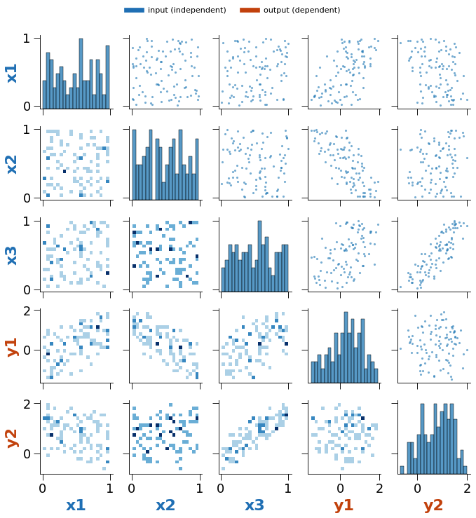
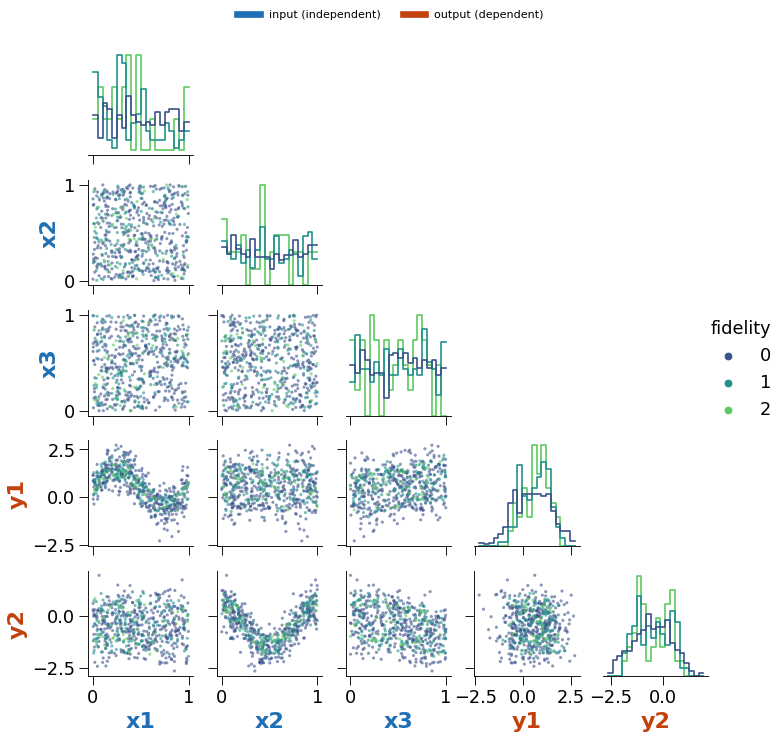
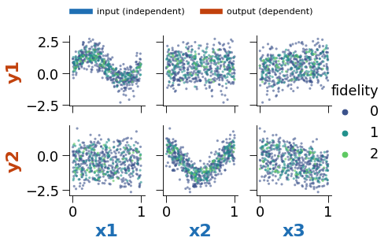

# Pair Plots in Reports

Whether the HTML reports should include a pair-plot matrix like the one on the
"Example Datasets" page, how large an input it can handle, and which options to
build in.

*Measured 2026-10-26 on `fix-wheel-and-increase-tests` (`3a0e00d`).*

## Recommendation

**Add it, opt-in per run, in a "fast" form, with hard limits.** A pair plot is
the quickest way to see the design (how the inputs were sampled) next to the
response (which inputs drive which outputs), and nothing in the reports does
that today. The UI's version should not be copied as-is: its KDE panels make the
run time grow with the number of rows, and on this machine a 4-variable plot of
20,000 rows took 82 s.

| Setting | Value | Why |
|---|---|---|
| Panels | Scatter above the diagonal, 2-D histogram below, histogram on the diagonal; no KDE | Time then depends on the number of panels only, not on rows |
| Rows plotted | At most 1,000, sampled (stratified by fidelity level when there is one) | Beyond ~1,000 points the picture does not change; the PNG does |
| Variables | Inputs and outputs together, at most 10 for the full matrix | ≤ 20 s and ~1.3 MB per image here; 12 is the hard ceiling |
| Above 10 variables | Switch to the outputs-vs-inputs grid (`n_out × n_in` panels), or skip with a note in the report | Cost grows with the square of the variable count |
| GUI control | Radio: **Off / Fast (default) / Full (with KDE)**; Full limited to 8 variables and a 1,000-row sample | The user decides; the report never waits on a plot they did not ask for |

## What Exists Today

- The "Example Datasets" page
  (`multioutreg/gui/pages/07_Other_Dataset_Examples.py`) draws a seaborn
  `PairGrid` per dataset: scatter above the diagonal, filled KDE below,
  histogram + KDE on the diagonal, over every numeric column and every row.
- `multioutreg/figures/doe_plots.make_doe_plot` is the same grid on a
  200-row sample. It is imported by `gui/grid_search_core.py` and
  `gui/Grid_Search_Surrogate_Models.py`, but every call is commented out.
- No report template or report generator includes a pair plot. The reports'
  `sampling_other_plots` and `other_plots` lists render any
  `{img_b64, title, caption}` item, so no template change is needed to add one.

## Benchmark

Each case ran in a fresh process with a 90 s timeout, built the grid on
synthetic data (inputs uniform, outputs linear in the inputs plus noise) and
encoded it as a PNG the way `safe_plot_b64` does (default dpi,
`bbox_inches="tight"`). Times include the PNG encode, which is about half of the
total. Machine: 2014 MacBook Pro, Intel i7-4870HQ, one thread
(`OMP_NUM_THREADS=1`), Python 3.9, matplotlib 3.8.2, seaborn 0.12. A current
laptop should be 2–3× faster; the limits above leave room for slower servers.

**Fast variant** (scatter / 2-D histogram / histogram, rows capped at 1,000,
`height=1.6`). Cells are total seconds, then base64 size of the PNG.

| Variables \ rows | 100 | 1,000 | 20,000 |
|---|---|---|---|
| 2 | 1.7 s, 16 KB | 0.9 s, 36 KB | 1.5 s, 20 KB |
| 4 | 4.1 s, 51 KB | 3.2 s, 156 KB | 3.4 s, 142 KB |
| 6 | 6.9 s, 95 KB | 7.5 s, 429 KB | 7.5 s, 429 KB |
| 8 | 11.6 s, 158 KB | 12.1 s, 803 KB | 13.1 s, 799 KB |
| 10 | 18.7 s, 242 KB | 18.4 s, 1.3 MB | 18.4 s, 1.3 MB |
| 12 | 26.0 s, 338 KB | 26.2 s, 1.9 MB | 25.3 s, 1.9 MB |
| 16 | 46.4 s, 569 KB | 47.0 s, 3.4 MB | 47.4 s, 3.4 MB |
| 20 | 73.8 s, 870 KB | 83.1 s, 5.5 MB | 75.6 s, 5.4 MB |
| 30 | > 90 s (timeout) | — | — |

Time is about 0.18 s per panel (`n_vars²` panels), whatever the row count, and
peak memory stayed under 560 MB.

**UI variant** (the "Example Datasets" grid: scatter / filled KDE / histogram +
KDE, all rows, default `height=2.5`). "—" means skipped because a smaller case
had already timed out.

| Variables \ rows | 100 | 500 | 1,000 | 5,000 | 20,000 |
|---|---|---|---|---|---|
| 2 | 0.8 s, 32 KB | 1.1 s, 44 KB | 1.4 s, 70 KB | 3.6 s, 96 KB | 12.2 s, 64 KB |
| 4 | 3.4 s, 105 KB | 5.4 s, 182 KB | 6.8 s, 279 KB | 21.4 s, 428 KB | 82.2 s, 458 KB |
| 6 | 12.4 s, 203 KB | 17.4 s, 433 KB | 17.1 s, 667 KB | 51.7 s, 1.2 MB | > 90 s |
| 8 | 14.4 s, 343 KB | 22.6 s, 764 KB | 30.7 s, 1.2 MB | > 90 s | — |
| 10 | 22.3 s, 532 KB | 34.7 s, 1.2 MB | 47.0 s, 1.9 MB | — | — |
| 12 | 33.4 s, 768 KB | 49.3 s, 1.7 MB | 68.7 s, 2.7 MB | — | — |
| 16 | 62.5 s, 1.3 MB | > 90 s | — | — | — |
| 20 | > 90 s | — | — | — | — |

The KDE panels make this one grow with rows as well as panels: at 1,000 rows
it is 2–3× slower than the fast variant, and at 4 variables it goes from 3 s
(100 rows) to 82 s (20,000 rows). A "Full" option is reasonable up to about
8 variables on a sample of at most 1,000 rows (≤ 31 s here).

`make_doe_plot` is the UI grid on 200 rows, so it sits between the 100- and
500-row columns of the table above.

Nothing crashed: every failure was a timeout. The limits come from time and
report size (every image is base64-embedded in the HTML), not from memory.

## Options

Prototype code for all of these is in the appendix. Each image below is a
rendered example.

### Colour labels by role

Input (independent) axis labels in blue, output (dependent) labels in orange,
with a key above the grid. Inputs are always listed first, so the
input-vs-input block (the design) is the top-left square and the
output-vs-input rows sit under it.



### Colour points by fidelity level

For multi-fidelity data, pass the fidelity column as the hue instead of
plotting it as a variable. (The UI's multi-fidelity example currently plots
`fidelity_level` as an ordinary numeric column, which gives a useless row of
three stripes.)

- Levels are drawn lowest first, so the scarce high-fidelity points end up on
  top.
- The palette is sequential (viridis), with level 0 (lowest fidelity) darkest,
  so colour order matches fidelity order.
- The diagonal uses step histograms normalised per level, so a level with 40
  points is not flattened by one with 400.
- Row sampling is stratified by level so that capping rows never removes a
  level.



### Corner (lower triangle only)

`corner=True` drops the mirrored upper triangle, roughly halving the time. It
suits the fidelity view, where the lower panels already carry the scatter.

### Outputs vs inputs

`PairGrid(x_vars=inputs, y_vars=outputs)` draws only the `n_out × n_in` panels
that show response behaviour. With 8 inputs and 2 outputs that is 16 panels
instead of 100. It is the fallback when the full matrix is over the limit.



### Smaller files

`rasterized=True` on the scatter layers and a lower dpi (80) for the report
image keep a 10-variable plot well under 1 MB.

## Handling Slow Plots

The report should never wait on a pair plot nobody asked for, and should never
fail because of one.

1. **Radio button, default Fast.** On the grid-search and multi-fidelity pages,
   add *Pair plot in report: Off / Fast / Full (KDE)*. With Off the report is
   built exactly as today.
2. **Check the cost before drawing.** Interrupting matplotlib mid-draw is not
   reliable, so estimate first from the table above: Fast costs about
   0.18 s × panels; Full also grows with rows. If the estimate is over budget,
   fall back to the outputs-vs-inputs grid. If that is still over, skip and put
   one line in the report ("Pair plot skipped: 14 variables, limit 10"). The
   user is not stopped and the report is never empty.
3. **Build it after the report.** Render and offer the report download first,
   then draw the pair plot and re-render the HTML with it added
   (`st.session_state` already keeps the run's results across reruns). The
   download is available after the model run, not after the plot.
4. **Never fail the report.** Wrap the call in `safe_plot_b64`, which already
   turns an exception into a small error image.

A hard timeout (drawing in a subprocess and killing it) would also work, but it
costs a process spawn and a data copy on every run, and the cost estimate makes
it unnecessary.

## Wiring It In

- `generate_html_report` (`gui/grid_search_core.py`,
  `report/auto_detect_report.py`, and the multi-fidelity page) receives
  `X_train` (possibly already PCA-transformed) and `y_test`, but not the raw
  frame. Add one optional argument, e.g. `pair_plot_b64: str | None`, built by
  the page from the cleaned training frame and the selected input, output and
  fidelity columns. Append it to `sampling_other_plots` when it is set.
- Put the plotting function next to `make_doe_plot` in
  `multioutreg/figures/doe_plots.py` (or replace it) with arguments
  `input_cols`, `output_cols`, `fidelity_col=None`, `layout="full"|"corner"|"io"`,
  `max_rows=1000`, `max_vars=10`.
- Tests: role colours on labels, stratified sampling keeps every level, the
  `max_vars` fallback and skip paths, and a timing guard on a small grid.

## Fidelity Numbering

The fidelity colouring assumes the package's convention: **level 0 is the
lowest fidelity and the last level is the highest.** This matches Kennedy &
O'Hagan (2000), Le Gratiet & Garnier (2014), Perdikaris et al. (2017), Cutajar
et al. (2019) and Takeno et al. (2020) (all ascending, 1-based), and SMT's `MFK`,
Emukit and continuous-fidelity BO (Wu et al. 2020: "1 is the highest fidelity
and 0 the lowest"), all 0-based.

Benchmark sources number the other way: Mainini et al. (2022) list levels "from
1 highest fidelity to 4 lowest", and all 49 BenchmarkFcns multi-fidelity
functions return the high fidelity in column 0. Reverse their order when
porting. Checking this turned up two problems, both fixed on this branch:

- `multioutreg.active.benchmarks` had the heterogeneous function's levels
  swapped, inherited from BenchmarkFcns (whose `heterogeneous` labels Mainini's
  `f_1` as the low fidelity, against both the paper and its own
  high-fidelity-first layout). The port now follows the paper.
- The multi-fidelity page sorted numeric levels as text, so with 11 or more
  levels the default order was `0, 1, 10, 2, …` and the wrong level was treated
  as the highest. Numeric levels now sort numerically.

`examples/mf_surrogates.ipynb` now names the Forrester levels `f0`–`f3`
(lowest to highest) instead of Mainini's `f1`–`f4` (highest to lowest).

## Appendix: Prototype

```python
import seaborn as sns
from matplotlib.lines import Line2D

INPUT_COLOR, OUTPUT_COLOR = "#1f6fb4", "#c2410c"


def make_pair_plot(df, input_cols, output_cols, fidelity_col=None, layout="full",
                   max_rows=1000, max_vars=12, height=1.8, seed=0):
    """layout: "full" (n x n), "corner" (lower triangle), "io" (outputs vs inputs)."""
    cols = list(input_cols) + list(output_cols)
    if len(cols) > max_vars:
        raise ValueError(f"{len(cols)} variables > max_vars={max_vars}")
    sub = df[cols + ([fidelity_col] if fidelity_col else [])]
    if len(sub) > max_rows:
        if fidelity_col:  # stratified, so no level disappears
            frac = max_rows / len(sub)
            sub = sub.groupby(fidelity_col, group_keys=False).apply(
                lambda g: g.sample(max(1, round(len(g) * frac)), random_state=seed))
        else:
            sub = sub.sample(max_rows, random_state=seed)

    hue_kw = {}
    if fidelity_col:
        levels = sorted(sub[fidelity_col].unique())  # 0 = lowest fidelity
        sub = sub.assign(**{fidelity_col: sub[fidelity_col].astype(str)})
        hue_kw = dict(hue=fidelity_col, hue_order=[str(l) for l in levels],
                      palette=sns.color_palette("viridis", len(levels)))

    scatter = dict(s=8, alpha=0.6, linewidth=0, rasterized=True)
    if layout == "io":
        g = sns.PairGrid(sub, x_vars=list(input_cols), y_vars=list(output_cols),
                         height=height, **hue_kw)
        g.map(sns.scatterplot, **scatter)
    else:
        g = sns.PairGrid(sub, vars=cols, corner=(layout == "corner"),
                         diag_sharey=False, height=height, **hue_kw)
        if layout == "full":
            g.map_upper(sns.scatterplot, **scatter)
        if fidelity_col:
            g.map_lower(sns.scatterplot, **scatter)
            g.map_diag(sns.histplot, element="step", fill=False,
                       common_norm=False, stat="density", bins=20)
        else:
            g.map_lower(sns.histplot, bins=20, cmap="Blues")
            g.map_diag(sns.histplot, bins=20)

    role = {c: INPUT_COLOR for c in input_cols} | {c: OUTPUT_COLOR for c in output_cols}
    for ax in g.axes.flat:
        if ax is None:
            continue
        for lab in (ax.xaxis.label, ax.yaxis.label):
            if lab.get_text() in role:
                lab.set_color(role[lab.get_text()])
                lab.set_fontweight("bold")
    g.fig.legend(handles=[Line2D([], [], color=INPUT_COLOR, lw=6, label="input (independent)"),
                          Line2D([], [], color=OUTPUT_COLOR, lw=6, label="output (dependent)")],
                 loc="lower center", bbox_to_anchor=(0.5, 1.0), ncol=2, frameon=False)
    if fidelity_col:
        g.add_legend(title="fidelity")
    return g
```
