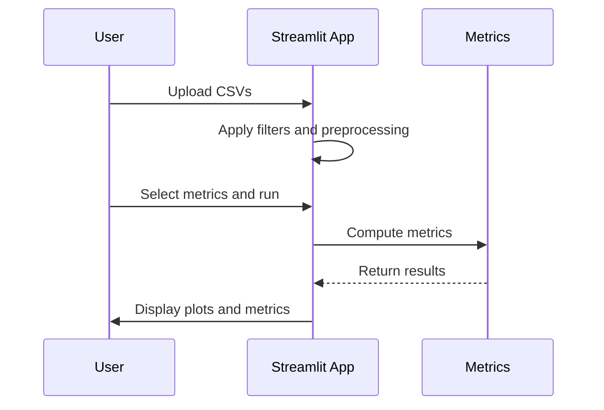

# Quickstart

Three ways to fit a multi-output surrogate with uncertainty: from Python, from
the `multioutreg` command line, or in the Streamlit GUI. Every example uses a
dataset bundled in
[`docs/_static/example_datasets/`](https://github.com/takotime808/multioutreg/tree/main/docs/_static/example_datasets)
and is run from the repository root.

Install first (see {doc}`install` for the optional extras):

```bash
git clone https://github.com/takotime808/multioutreg.git && cd multioutreg
pip install .
```

## Python

`AutoDetectMultiOutputRegressor` cross-validates every candidate model on every
output and keeps the best one per output. Below, it chooses between a linear
model, a random forest and a Gaussian process for a dataset with five inputs
and three outputs (pressure, temperature, velocity), then adds 90% conformal
prediction intervals.

```python
import pandas as pd
from sklearn.ensemble import RandomForestRegressor
from sklearn.gaussian_process import GaussianProcessRegressor
from sklearn.linear_model import LinearRegression
from sklearn.model_selection import train_test_split

from multioutreg import AutoDetectMultiOutputRegressor

df = pd.read_csv("docs/_static/example_datasets/example_dataset_3_outputs.csv")
X = df.filter(like="feature_").to_numpy()
Y = df.filter(like="output_").to_numpy()

# Hold out a test set, then split a calibration set off the training data.
X_train, X_test, Y_train, Y_test = train_test_split(X, Y, test_size=0.2, random_state=0)
X_fit, X_cal, Y_fit, Y_cal = train_test_split(X_train, Y_train, test_size=0.25, random_state=0)

model = AutoDetectMultiOutputRegressor(
    estimators=[LinearRegression(), RandomForestRegressor(random_state=0),
                GaussianProcessRegressor(normalize_y=True)],
    param_spaces=[{}, {"max_depth": [None, 6]}, {}],
).fit(X_fit, Y_fit)

print(model.cv_description_)
print([type(m).__name__ for m in model.models_])  # chosen model per output

mean, std = model.predict(X_test, return_std=True)

model.calibrate_conformal(X_cal, Y_cal)
lower, upper = model.predict_interval(X_test, alpha=0.1)  # 90% intervals
print(((Y_test >= lower) & (Y_test <= upper)).mean(axis=0))
```

```text
10-Fold CV (shuffled)
['RandomForestRegressor', 'GaussianProcessRegressor', 'RandomForestRegressor']
[0.88333333 0.9        0.9       ]
```

The cross-validation scheme is chosen from the number of rows. Each output gets
its own model, and the intervals cover about 90% of the held-out points, as
intended.

To search every surrogate shipped with the library (gradient boosting, GP
variants, Bayesian neural networks and more) instead of a hand-picked list,
use `AutoDetectMultiOutputRegressor.with_vendored_surrogates()`. See
{doc}`integrated_surrogates` for the full list.

## Command line

Installing the package adds a `multioutreg` command. Run it with no arguments
to list the subcommands, or add `--help` to any subcommand for its options.

| Command | What it does |
|---|---|
| `grid_search_auto_detect` | Auto-detect the best surrogate per output and write an HTML report |
| `grid_search` | Grid search over surrogates and write an HTML report |
| `detect_sampling` | Infer how an input design was sampled (grid, LHS, Sobol or random) |
| `compare_sample_methods` | Same, with the input distributions given in a YAML file and KS tests of fit |
| `ts-forecast` | Zero-shot probabilistic time-series forecasts with Chronos (needs the `ts` extra) |
| `ts-pipeline` | Train and rank ARIMA, SARIMA and LSTM on a time series and save the best |

Fit and report on the six-input, two-output sample dataset:

```bash
multioutreg grid_search_auto_detect \
    docs/_static/example_datasets/sample_data.csv \
    "x0,x1,x2,x3,x4,x5" "y0,y1" \
    --conformal --out-html report.html
```

This cross-validates every vendored surrogate on every output, so expect it to
run for a while: about 20 minutes on a laptop CPU, even for this 10-row file.
Open `report.html` for per-output metrics, uncertainty plots and the chosen
models.

Check how a design was sampled, leaving out the response column:

```bash
multioutreg detect_sampling docs/_static/example_datasets/lhs_sampled_dataset.csv --exclude response
```

```text
Columns tested: x1, x2
Detected sampling: LHS
```

### Time-series forecasting

| Command | Approach | When to use |
|---|---|---|
| `ts-forecast` | Zero-shot (Chronos foundation model) | No training needed; fast quantile forecasts from a pre-trained model |
| `ts-pipeline` | Trained statistical and deep models (ARIMA, SARIMA, LSTM) | Fit models on your own data, rank them by RMSE, MAE and MAPE, and save the best |

```bash
multioutreg ts-forecast data.csv \
    --time-col "Date" --value-cols "revenue" \
    --horizon 30 --model amazon/chronos-bolt-base \
    --out forecast.csv

multioutreg ts-pipeline data.csv \
    --target-col "revenue" --datetime-col "Date" \
    --freq 1D --out-dir ts_pipeline_output/
```

`ts-pipeline` aggregates row-level data (e.g. one row per order) to the target
frequency (`--agg`, default `sum`) and converts percentage-formatted columns to
numbers. See {doc}`tutorials/forecasting_with_chronos` for more.

## GUI

The same workflows are available in a Streamlit app. Try the
[hosted version](https://multioutreg.streamlit.app/), or run it locally:

```bash
.venv/bin/streamlit run multioutreg/gui/Grid_Search_Surrogate_Models.py
```

Use the `streamlit` from the project environment. One from another Python
(e.g. a base conda env) fails with import errors.



The sidebar has pages for multi-fidelity models ({doc}`multi_fidelity_gui`),
sampling detection, time-series forecasting and example datasets. Any CSV in
`docs/_static/example_datasets/` works as an upload. To use the best model the
app finds in your own code, see {doc}`tutorials/using_the_exported_model`.

## Next steps

- {doc}`tutorials/multi_output_surrogates`: model selection, uncertainty, SHAP
  and partial dependence, start to finish.
- {doc}`tutorials/active_learning_benchmarks`: choose the next runs to reach an
  accuracy target with fewer of them.
- {doc}`tutorials/multi_fidelity_surrogates`: combine cheap and expensive
  models.
